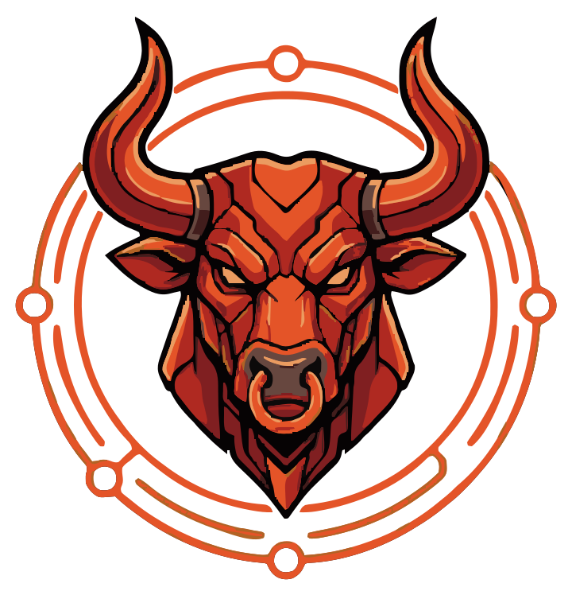
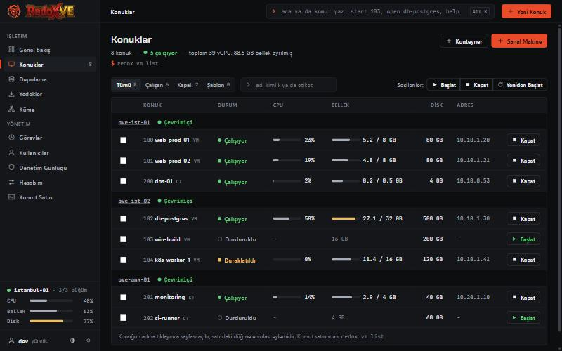
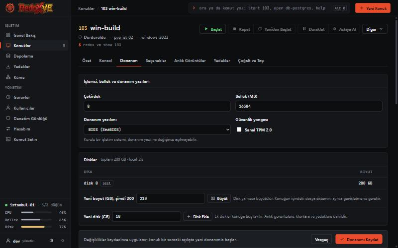
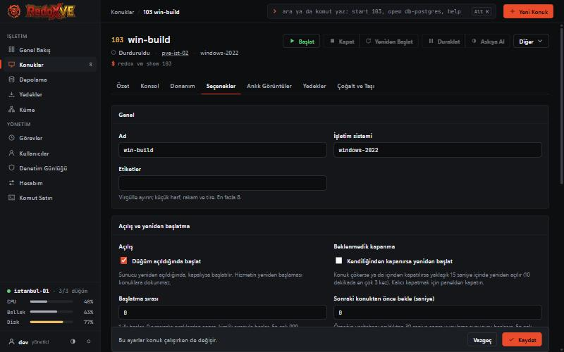
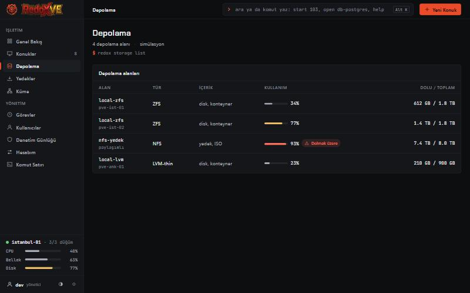
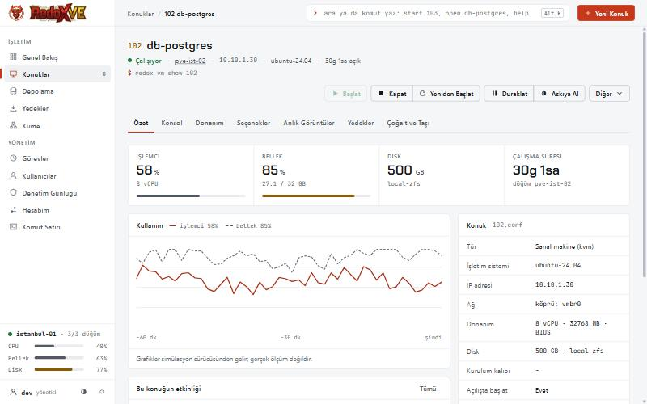
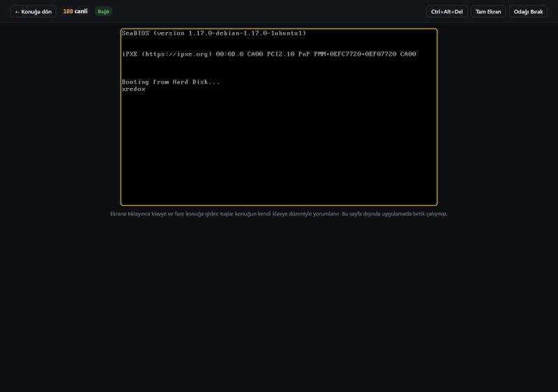

<p align="center">
  
  &nbsp;&nbsp;
  
</p>

<p align="center">
  <b>English</b> · <a href="README.tr.md">Türkçe</a>
</p>

# RedoX VE

RedoX VE is a self-hosted virtualization platform written in Rust. One binary, `redox`, runs KVM virtual
machines and unprivileged LXC containers on a Linux server and gives you a web panel, a REST API and a
command-line client for them.

It is built for a single server or a handful of independent servers: a home lab, a small office, a
development host. It is not a clustered hypervisor (see [Limits](#limits)).

> **Language:** the web panel, the CLI help text and the detailed installation guide
> ([KURULUM.md](KURULUM.md)) are currently in Turkish. This README covers installation and the technical
> design in English.


## Contents

- [Features](#features)
- [Screenshots](#screenshots)
- [Installation](#installation)
- [Command line and API](#command-line-and-api)
- [Technical documentation](#technical-documentation)
- [Security model](#security-model)
- [Testing](#testing)
- [Limits](#limits)
- [License](#license)

## Features

**Guests**

- KVM virtual machines through QEMU, and unprivileged LXC containers, managed from the same pages.
- BIOS, UEFI, UEFI with secure boot, and a virtual TPM 2.0 (enough for Windows 11).
- Install from an ISO, or create from a cloud image with cloud-init (user, SSH key, host name).
- Import `vmdk`, `vdi`, `vhdx` disks and OVA archives; export a guest as OVA.
- Templates, full clones and linked clones (a linked clone is ready in under a second).
- Up to 8 extra data disks and 3 extra network cards; both can be hot-plugged into a running VM.
- Suspend to disk and resume, pause, scheduled start/stop/reboot, start order at host boot.
- Automatic restart of a guest that crashed or shut itself down.
- Shared folders between host and VM (virtio-9p), USB and PCI passthrough.

**Storage and backup**

- Live snapshots (including memory) and live backups of running VMs.
- Scheduled backups with retention.
- Incremental backups: a content-addressed 4 MiB chunk store with no chains, so any backup can be deleted.
- Changed-block tracking, so an incremental backup of a running VM reads only the blocks that changed.
- Off-site copies to a directory (second disk, NFS, SMB) or any S3-compatible store, with client-side
  encryption. Encrypted copies are bound to the backup's name, so swapped files are rejected on restore.
- Backup verification, and repair of a damaged local chunk from the off-site copy.
- Additional storage directories for VM disks.

**Network**

- User-mode NAT with port forwarding, or bridged networking.
- VLAN tags per network card, and disk and network rate limits per guest.
- Per-guest inbound firewall (nftables).

**Operations**

- Server-rendered web panel with dark and light themes, usable without JavaScript.
- Live graphical console in the browser, with keyboard and mouse.
- Roles (admin, operator, viewer), tag-based operator scopes, TOTP two-factor login, OpenID Connect.
- Audit log, task log, resource alerts by webhook or e-mail, Prometheus metrics.
- A combined view of several RedoX VE servers, and moving a VM between them while keeping its memory state.

## Screenshots

The screenshots show the panel running with the built-in simulation driver, which displays a sample cluster.

| Guests | Guest summary |
|---|---|
|  |  |

| Hardware | Options |
|---|---|
|  |  |

| Storage | Light theme |
|---|---|
|  |  |

Live console, connected to a real QEMU guest:



## Installation

These steps target Debian 12 or Ubuntu 22.04 and later (systemd, x86_64). Replace `redox.example.com`
with your own name. The full guide, with every option explained, is [KURULUM.md](KURULUM.md) (Turkish).

### 1. Build

Copy the source tree to the server, then:

```bash
sudo apt update && sudo apt install -y build-essential curl
curl --proto '=https' --tlsv1.2 -sSf https://sh.rustup.rs | sh -s -- -y --profile minimal
source "$HOME/.cargo/env"

cd Proxmox-Rust
cargo test --workspace
cargo build --release
sudo install -m 0755 target/release/redox /usr/local/bin/redox
```

### 2. Service user and first administrator

There is no default account. The server refuses to start until a user exists.

```bash
sudo useradd --system --home-dir /var/lib/redox --shell /usr/sbin/nologin redox
sudo install -d -o redox -g redox -m 0700 /var/lib/redox
sudo -u redox redox user add admin --users /var/lib/redox/users.json
```

The password is asked twice, is not echoed, and must be at least 12 characters.

### 3. systemd service

```bash
sudo cp deploy/redox.service /etc/systemd/system/redox.service
sudo systemctl daemon-reload
sudo systemctl enable --now redox
curl -s http://127.0.0.1:8006/healthz
```

The last command prints `ok`. At this point the server runs the simulation driver, which starts nothing
real and shows a sample cluster.

### 4. TLS

RedoX VE does not terminate TLS and refuses to listen in plain HTTP on anything but `127.0.0.1`. Put
[Caddy](https://caddyserver.com/docs/install) in front of it:

```bash
sudo cp deploy/Caddyfile /etc/caddy/Caddyfile
sudo nano /etc/caddy/Caddyfile
sudo systemctl reload caddy
sudo ufw allow OpenSSH && sudo ufw allow 80,443/tcp && sudo ufw enable
```

Do not open port 8006. Without a domain name, skip Caddy, remove `--behind-tls-proxy` from the unit file
and use an SSH tunnel instead: `ssh -L 8006:127.0.0.1:8006 user@server`.

### 5. Real virtual machines

```bash
sudo apt install -y qemu-system-x86 qemu-utils
ls -l /dev/kvm
sudo cp deploy/redox-qemu.service /etc/systemd/system/redox.service
sudo systemctl daemon-reload && sudo systemctl restart redox
journalctl -u redox -n 20 --no-pager
```

The log should show the `qemu-kvm` driver. If `/dev/kvm` is missing, enable virtualization in the
firmware; otherwise QEMU falls back to software emulation, which is very slow.

Optional pieces, each described in [KURULUM.md](KURULUM.md):

| Need | Packages | Section |
|---|---|---|
| UEFI, secure boot, TPM | `ovmf`, `swtpm` | 8 |
| Bridged networking, LXC containers | `lxc`, `uidmap`, `acl`; unit `deploy/redox-host.service` | 9 |
| VLAN tags, network rate limits | `iproute2`, `CAP_NET_ADMIN` | 8 |
| Guest firewall | `nftables`, `CAP_NET_ADMIN`, `--firewall` | 12 |
| Alerts, several servers | `--alert-webhook`, `--alert-email`, `--peers` | 10 |
| Off-site backups | `--offsite` | 11 |
| Single sign-on | `--oidc` | 13 |

### Trying it on your own machine

The simulation driver also runs on Windows and macOS, which is enough to look around the panel:

```bash
cargo build
./target/debug/redox user add admin --users users.json
./target/debug/redox serve --users users.json
```

Then open `http://127.0.0.1:8006`.

## Command line and API

The same binary is the client. Create a token on the server (it is shown once):

```bash
sudo -u redox redox token create admin laptop --users /var/lib/redox/users.json
```

Then, from any machine:

```bash
export REDOX_URL=https://redox.example.com
export REDOX_TOKEN=redox_...

redox cluster status
redox vm list
redox vm start 103
redox vm set 103 cores=4 memory=8192 tags=prod,web backup-time=03:30
redox vm disk add 103 20
redox snapshot create 103 before-upgrade
redox backup create 103
redox backup restore vm-103-1795546651
redox task list
```

`redox --help` lists every command.

The REST API lives under `/api/v1` and takes `Authorization: Bearer <token>`. State-changing calls return
a task; poll `/api/v1/tasks/{id}` for the result.

| Method and path | Purpose |
|---|---|
| `GET /cluster`, `GET /nodes`, `GET /nodes/{id}` | Cluster and node status |
| `GET /guests`, `POST /guests` | List and create guests |
| `GET`, `PATCH`, `DELETE /guests/{vmid}` | Show, change, destroy |
| `POST /guests/{vmid}/{start,stop,reboot,pause,resume}` | Power actions |
| `POST /guests/{vmid}/suspend`, `/discard-suspend` | Suspend to disk |
| `POST /guests/{vmid}/snapshots`, `.../{name}/rollback` | Snapshots |
| `POST /guests/{vmid}/clone`, `/template`, `/resize`, `/disks`, `/nics` | Clones and hardware |
| `GET /guests/{vmid}/export` | OVA export |
| `POST /guests/{vmid}/backups`, `GET /backups` | Backups |
| `POST /backups/{id}/restore`, `/push`, `/verify`, `GET .../download` | Restore, off-site, verify, download |
| `GET /storage`, `GET /media`, `PUT /media/{name}`, `POST /media/fetch` | Storage, ISO and image upload |
| `GET /peers`, `POST /peers/{name}/import/{vmid}` | Other servers, VM import |
| `GET /tasks`, `GET /tasks/{id}` | Task log |

`GET /metrics` (outside `/api/v1`) serves Prometheus metrics with the same token.

## Technical documentation

### Layout

```
crates/
  redox-core/     Domain model and rules. No I/O, no async.
  redox-server/   The `redox` binary: HTTP server, drivers, CLI.
deploy/           systemd units and a Caddyfile.
docs/img/         Screenshots used in this README.
KURULUM.md        Detailed installation and operations guide (Turkish).
```

About 23,700 lines of Rust in the two crates.

### `redox-core`

| Module | Contents |
|---|---|
| `model`, `hw` | Guests, nodes, storage, snapshots, backups, tasks; the hardware description of a guest |
| `cluster`, `ops` | The state machine: which operation is allowed in which state, guest locking, task bookkeeping |
| `driver` | The `Hypervisor` trait that every backend implements, and the `Remote` trait for off-site targets |
| `command` | The command grammar shared by the CLI and the panel's command bar |
| `seed` | The sample cluster shown by the simulation driver |

Every rule lives here and is tested without a hypervisor. The server only decides *how* an operation is
carried out; `redox-core` decides *whether* it may happen.

### `redox-server`

| Area | Modules |
|---|---|
| HTTP | `lib` (router, security headers), `api` (REST), `ui`, `ui_ops`, `ui_admin` (page handlers), `view*` (HTML with [maud](https://maud.lambda.xyz)) |
| State | `state` (application state, task runner, schedulers), `history` and `metrics` (graphs, Prometheus) |
| Drivers | `qemu` (QEMU/KVM over QMP), `lxc`, `hostdriver` (combines the two), `qga` (guest agent) |
| Backup | `chunkstore` (incremental store), `offsite` (directory and S3 targets, encryption), `ova` |
| Network | `net`, `netlimit` (`tc`), `firewall` (nftables) |
| Identity | `auth` (users, sessions, tokens), `totp`, `oidc`, `audit` |
| Operations | `alerts`, `mail`, `ha` (restart watchdog), `peers` (other servers), `media` (ISO and image upload) |
| Client | `cli`, `main` |

### How an operation runs

1. A request arrives from the panel (form POST), the API or the CLI (which calls the API).
2. `redox-core` checks the rule and, if allowed, locks the guest and records a task.
3. The task runs on a background thread against the driver.
4. The result is written to the task log and the guest is unlocked. A failed task leaves the guest as it was.

State is a single JSON file (`state.json`), written atomically. Guests keep running when the service
restarts and are adopted again on start.

### QEMU driver

Each VM is one QEMU process started with a fixed, versioned device layout:

- Control over a QMP Unix socket in the data directory.
- Display over a VNC Unix socket (no password, never on the network).
- PCIe root ports reserved for hot-plug: eight for disks, three for network cards.
- The layout version is recorded with a suspended guest, so it resumes with the layout it was saved with.

Data directory (`/var/lib/redox`):

| Path | Contents |
|---|---|
| `images/` | Guest disks (qcow2), suspend state, changed-block maps |
| `iso/`, `cloud/` | Installation media and cloud images |
| `backups/`, `backups/chunks/` | Full backups and the incremental chunk store |
| `shares/` | Shared folders |
| `run/` | QMP and VNC sockets, pid files |
| `state.json`, `users.json`, `sessions.json`, `audit.log`, `metrics.json` | Records |

### Backups

- **Full:** one compressed qcow2 per disk. A running VM is backed up with a QEMU backup job; with several
  disks the jobs start in one transaction.
- **Incremental** (`--incremental-backups`): the disk is cut into 4 MiB chunks named by their SHA-256.
  Each backup is a complete list of chunks, so there is no chain to break. Zero regions are not stored.
- **Changed-block tracking** (`--changed-block-tracking`): a persistent QEMU dirty bitmap. It is dropped,
  and the next backup reads the whole disk, whenever it might be wrong (restore, rollback, resize, crash).
- **Off-site:** ChaCha20-Poly1305 in 64 KiB chunks, key derived with Argon2id. The file's name is
  authenticated with every chunk.

### Web panel and live console

Pages are rendered on the server and work without JavaScript; the content security policy is
`script-src 'none'`. Fonts and icons are embedded in the binary, so a page makes no external request.

The live console is the one exception. That page loads a single script served by RedoX VE itself: an RFB
3.8 (VNC) client of about 300 lines. The server checks the session and the permission, then bridges the
browser's WebSocket to the guest's VNC Unix socket. Keys are sent as scancodes, so the guest's own keyboard
layout decides the character.

## Security model

| Layer | What it does |
|---|---|
| Identity | User name and password (Argon2id). No default account. |
| Session | 256-bit random cookie; `HttpOnly`, `SameSite=Strict`, `Secure` behind TLS. Ends after 2 hours idle or 12 hours. |
| Brute force | 5 failed attempts in 15 minutes for the same address and user locks for 15 minutes. |
| Second factor | Optional TOTP; a code is accepted once. |
| Roles | `admin` does everything, `operator` runs guests within its scope, `viewer` only reads. |
| Audit | Logins, refused attempts and every state-changing request go to `audit.log`. |
| API | Bearer tokens, stored only as SHA-256 digests. |
| Browser | Cross-site POSTs and cross-site console connections are refused; no framing; HSTS. |
| Process | Unprivileged `redox` user, systemd sandbox, files `0600`. |

## Testing

```bash
cargo test --workspace
cargo clippy --workspace --all-targets
```

381 tests pass on Linux and 336 on Windows (the QEMU and LXC driver tests are Linux-only). The driver
tests run against a fake QEMU that speaks QMP. If Node.js is installed, the live console client's own
7 tests run as well.

Beyond the test suite, the QEMU driver has been exercised against real QEMU 10.2 with KVM: snapshots,
full and incremental backups, changed-block tracking, off-site copies, suspend and resume, hot-plug,
VLAN and rate limits, the live console, and moving a running VM between two servers.

Not yet verified on a real server: the systemd units and the Caddy configuration, bridged networking,
LXC containers, the guest firewall, a real S3 provider, a real SMTP or OpenID Connect provider, and
USB/PCI passthrough. [KURULUM.md](KURULUM.md) marks each of these where it is described.

## Limits

- No shared cluster state. Several servers can be viewed together, but each one manages its own guests.
- Moving a running VM keeps its memory but pauses it while disk and memory are copied. It is not a
  zero-downtime live migration.
- No automatic failover between servers. A crashed guest is restarted on the same server only.
- No LVM or ZFS storage pools, no resource quotas, no container clones.
- A guest cannot be moved to another storage after creation.
- The live console has no clipboard or audio.
- The interface is Turkish only.

## License

No license has been chosen yet. Until one is added, all rights are reserved by the author.
