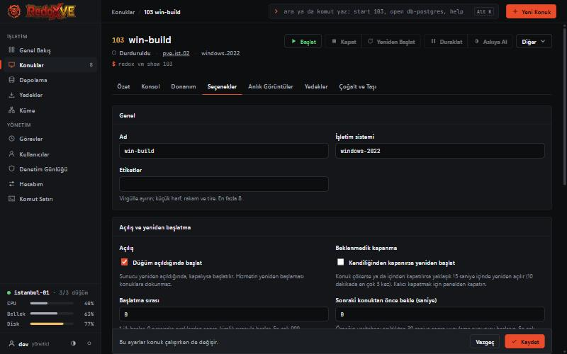
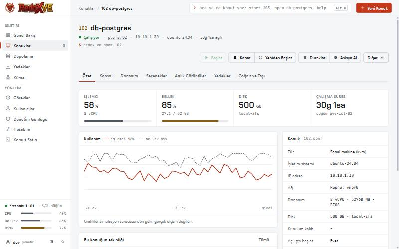

<p align="center">
  
  &nbsp;&nbsp;
  
</p>

<p align="center">
  <a href="README.md">English</a> · <b>Türkçe</b>
</p>

# RedoX VE

RedoX VE, Rust ile yazılmış, kendi sunucunuza kurduğunuz, [Proxmox VE](#redox-ve-ve-proxmox-ve) benzeri
bir sanallaştırma platformudur. Tek bir program
(`redox`) bir Linux sunucuda KVM sanal makinelerini ve yetkisiz LXC konteynerlerini çalıştırır; bunları
yönetmek için bir web paneli, bir REST API ve bir komut satırı istemcisi sunar.

Tek bir sunucu ya da birbirinden bağımsız birkaç sunucu için tasarlandı: ev laboratuvarı, küçük ofis,
geliştirme sunucusu. Kümelenmiş bir sanallaştırıcı değildir ([Sınırlar](#sınırlar) bölümüne bakın).


## İçindekiler

- [Özellikler](#özellikler)
- [RedoX VE ve Proxmox VE](#redox-ve-ve-proxmox-ve)
- [Ekran görüntüleri](#ekran-görüntüleri)
- [Kurulum](#kurulum)
- [Komut satırı ve API](#komut-satırı-ve-api)
- [Teknik doküman](#teknik-doküman)
- [Güvenlik modeli](#güvenlik-modeli)
- [Testler](#testler)
- [Sınırlar](#sınırlar)
- [Lisans](#lisans)

## Özellikler

**Konuklar**

- QEMU üzerinden KVM sanal makineleri ve yetkisiz LXC konteynerleri; ikisi de aynı sayfalardan yönetilir.
- Konteynerler klonlanır ve çalışırken yedeklenir (arşiv süresince dondurulur).
- BIOS, UEFI, güvenli önyüklemeli UEFI ve sanal TPM 2.0 (Windows 11 için yeterli).
- ISO'dan kurulum ya da hazır bulut imajından cloud-init ile oluşturma (kullanıcı, SSH anahtarı, makine adı).
  cloud-init ayarları, sabit adres dahil, sonradan panelden düzenlenir.
- Sanal makine başına seçilebilen işlemci modeli ve hedefi çalışırken değişen bellek balonu.
- `vmdk`, `vdi`, `vhdx` disklerini ve OVA arşivlerini içe aktarma; konuğu OVA olarak dışa aktarma.
- Şablonlar, tam klonlar ve bağlı klonlar (bağlı klon bir saniyenin altında hazır olur).
- En fazla 8 ek veri diski ve 3 ek ağ kartı; ikisi de çalışan sanal makineye takılabilir.
- Diske askıya alma ve kaldığı yerden sürdürme, duraklatma, zamanlanmış başlatma/kapatma/yeniden başlatma,
  sunucu açılışında başlatma sırası.
- Çöken ya da içinden kapanan konuğun kendiliğinden yeniden başlatılması.
- Sunucu ile sanal makine arasında paylaşılan klasörler (virtio-9p), USB ve PCI aygıt aktarımı.
- Dinamik bellek (balon hedefi konuğun kullanımını izler) ve iç içe sanallaştırma.
- Konuk başına kaynak ölçümü: faturalama ve planlama için birikimli çekirdek-saat, GB-saat ve disk G/Ç.
- Köprüdeki kartlarda ağ kartı koruması: sahte MAC, sahte DHCP sunucusu ve yönlendirici duyurusu engellenir.
- Bakım kipi: sunucu güncellemesinden önce konukları kapatır, sonra yeniden başlatır.
- Konuk içi disk doluluğu (ajanla) ve uyarısı; uyarılar web kancası, e-posta, ntfy ve Telegram ile gider.
- Salt okunur API token'ları ve isteğe bağlı API hız sınırı.
- Yerel yedek şifrelemesi (`--backup-passphrase-file`): artımlı yedek parçaları diskte şifreli durur.
- Hakemli kendiliğinden devralma: kaynak sunucu ölünce ve üçüncü bir sunucu onaylayınca yedek kopya başlatılır.
- Artımlı çoğaltma: ilk turdan sonra ağdan yalnızca değişen 4 MiB'lik bloklar geçer; her blok özetiyle doğrulanır.
- Konteynerler sunucular arasında kopyalanır ve çoğaltılır; yedek alanının ne zaman dolacağı tahmin edilir; kaynak
  ölçümü ve denetim günlüğü CSV olarak indirilir; imaj kataloğunda virtio-win sürücü kalıbı vardır.
- Baştan sona Türkçe ve İngilizce: üst çubukta dil düğmesi, sunucu varsayılanı için `--lang en`, API hata iletileri
  `Accept-Language` başlığına göre, komut satırı `REDOX_LANG=en` ile.

**Depolama ve yedek**

- Çalışan sanal makinede anlık görüntü (bellekle birlikte) ve yedek.
- Saklama sayısıyla zamanlanmış yedek: konuk başına ya da birçok konuğu sırayla yedekleyen yedek işleriyle.
- UEFI değişkenleri ve sanal TPM durumu yedekle birlikte saklanır ve geri yüklenir.
- Yedeği yeni bir konuk olarak açma ya da konuğu doğrudan yedeğin üzerinde başlatma (anında kurtarma) ve sonradan ayırma.
- Açarak sınama: yedek, yalıtılmış geçici bir konukta başlatılarak gerçekten açıldığı kanıtlanır; istenirse bir
  TCP kapısının yanıt vermesi ve konuk içinde bir komutun başarıyla bitmesi de beklenir.
- Üretim denetim noktası: çalışan sanal makinenin, dosya sistemleri konuk ajanıyla dondurularak alınan belleksiz
  görüntüsü.
- Artımlı yedekte olağandan çok fazla veri değiştiğinde uyarı (fidye yazılımı belirtisi olabilir).
- Konuk başına yedek yaşı hedefi (RPO) ve arşiv: kopya hedefleri, yerelde silinen yedekleri belirlenen gün kadar
  saklayabilir.
- Dört göz ilkesi (isteğe bağlı): yedek, konuk, disk, yedek işi ya da kullanıcı silmek ikinci bir yöneticinin
  onayını ister.
- Çoğaltma: eş sunucudaki sanal makinenin, aralıkla tazelenen ve devralmada elle başlatılan yedek kopyası.
- En yeni yedeklerin zamanlanmış açarak sınanması ve hazır bulut imajı kataloğu.
- Dosya düzeyinde geri yükleme: yedeğin içinde gezip tek dosya indirme (libguestfs ile).
- Haftalık, aylık, yıllık saklama (GFS), kilitli (değiştirilemez) yedekler, yedek penceresi ve kopyalama hız sınırı.
- Canlı yedekten önce ve sonra konuk ajanıyla konuğun içinde komut çalıştırma.
- E-postayla günlük yedek raporu ve yakın zamanda yedeği alınmamış konukların listesi.
- Artımlı yedek: içeriğe göre adlandırılan 4 MiB'lik parça deposu. Zincir yoktur; herhangi bir yedek silinebilir.
- Değişen blok takibi: çalışan sanal makinenin artımlı yedeğinde yalnızca değişen bloklar okunur.
- Bir dizine (ikinci disk, NFS, SMB) ya da S3 uyumlu bir depoya dış kopya; şifreleme istemci tarafındadır.
  Şifreli kopya yedeğin adına bağlıdır: hedefte yer değiştirilen dosyalar geri yüklemede reddedilir.
  Büyük dosyalar S3'e parça parça yüklenir. Yedekler birden çok hedefe kopyalanabilir (3-2-1).
- Yedek doğrulama ve yerelde bozulan parçanın dış kopyadan onarılması.
- Sanal makine diskleri için ek depolama dizinleri ve kapalı konuğun disklerini aralarında taşıma.
- Çekirdek, bellek, disk ve konuk sayısına kota koyan kaynak havuzları.

**Ağ**

- Port yönlendirmeli kullanıcı kipi NAT ya da köprü ağı.
- Ağ kartı başına VLAN etiketi; konuk başına disk ve ağ hız sınırı.
- Konuk başına gelen trafik güvenlik duvarı (nftables).

**İşletim**

- Sunucuda üretilen web paneli; koyu ve açık tema; JavaScript olmadan kullanılır.
- Tarayıcıda klavye ve fareyle canlı grafik konsol.
- Roller (yönetici, operatör, izleyici), etikete dayalı operatör kapsamı, TOTP ile iki adımlı giriş,
  OpenID Connect.
- Denetim günlüğü, görev günlüğü, webhook ya da e-posta ile kaynak uyarıları, Prometheus ölçümleri.
- Birkaç RedoX VE sunucusunun birleşik görünümü ve bir sanal makineyi bellek durumu, ek diskleri, UEFI
  değişkenleri ve TPM durumuyla birlikte aralarında taşıma.

## RedoX VE ve Proxmox VE

RedoX VE, [Proxmox VE](https://www.proxmox.com/en/proxmox-virtual-environment/overview) örnek alınarak
tasarlandı. Proxmox kullandıysanız fikirleri tanırsınız: 100'den başlayan sayısal konuk kimlikleri, yan yana
sanal makineler ve konteynerler, `vmbr0` biçimli köprüler, görev günlüğü, konuk başına anlık görüntü ve
yedek, 8006 numaralı kapıdaki panel.

Rust ile sıfırdan yazılmış bağımsız bir projedir. Proxmox VE ile ortak kodu yoktur, Proxmox'un ayar ve
yedek biçimlerini okumaz ve onun yerine doğrudan konabilecek bir ürün değildir.

| | Proxmox VE | RedoX VE |
|---|---|---|
| Biçim | Makineye kurduğunuz, Debian tabanlı bir dağıtım | Var olan Debian ya da Ubuntu sunucuya eklediğiniz tek bir program |
| Konuklar | KVM sanal makineleri, LXC konteynerleri | KVM sanal makineleri, LXC konteynerleri |
| Küme | Ortak durumlu çok düğümlü küme, canlı taşıma ve yüksek erişilebilirlik | Birleşik görünümlü bağımsız sunucular; çalışan sanal makine kısa bir duraklamayla taşınır |
| Depolama | LVM, ZFS, Ceph, NFS ve fazlası | Dizinler (yerel disk ya da bağlı bir paylaşım), qcow2 |
| Yedek | vzdump ve Proxmox Backup Server | Gömülü tam ve artımlı yedek, dizine ya da S3'e dış kopya |
| Web paneli | JavaScript uygulaması | Sunucuda üretilen HTML; canlı konsol dışında JavaScript yok |
| Olgunluk | Yıllardır üretimde | Yeni; bazı parçaları gerçek sunucuda henüz denenmedi ([Testler](#testler)) |

Kümeye, ortak depolamaya ya da kendini kanıtlamış bir platforma ihtiyacınız varsa Proxmox VE'yi seçin.
RedoX VE, küçük, denetlenebilir ve sıkı varsayılanlı bir hizmetin geniş özellik listesinden daha değerli
olduğu tek sunucuyu hedefler.

*Proxmox, Proxmox Server Solutions GmbH'nin tescilli markasıdır. RedoX VE'nin Proxmox Server Solutions GmbH
ile bir bağı yoktur ve onun tarafından desteklenmez.*

## Ekran görüntüleri

Görüntüler, panelin gömülü simülasyon sürücüsüyle çalışırken alındı; bu sürücü örnek bir küme gösterir.

| Konuklar | Konuk özeti |
|---|---|
|  |  |

| Donanım | Seçenekler |
|---|---|
|  |  |

| Depolama | Açık tema |
|---|---|
|  |  |

Gerçek bir QEMU konuğuna bağlı canlı konsol:


## Kurulum

Adımlar Debian 12 ya da Ubuntu 22.04 ve sonrası (systemd, x86_64) içindir. `redox.example.com` yerine
kendi adınızı yazın. Her seçeneğin açıklandığı eksiksiz kılavuz: [KURULUM.md](KURULUM.md).
> Konu başına ayrı sayfalardan oluşan wiki: [docs/wiki/tr](docs/wiki/tr/Ana-Sayfa.md) ([English](docs/wiki/en/Home.md)).

### 1. Derleme

Kaynak ağacını sunucuya kopyalayın, sonra:

```bash
sudo apt update && sudo apt install -y build-essential curl
curl --proto '=https' --tlsv1.2 -sSf https://sh.rustup.rs | sh -s -- -y --profile minimal
source "$HOME/.cargo/env"

cd Proxmox-Rust
cargo test --workspace
cargo build --release
sudo install -m 0755 target/release/redox /usr/local/bin/redox
```

### 2. Hizmet kullanıcısı ve ilk yönetici

Varsayılan hesap yoktur. Bir kullanıcı oluşturulmadan sunucu başlamaz.

```bash
sudo useradd --system --home-dir /var/lib/redox --shell /usr/sbin/nologin redox
sudo install -d -o redox -g redox -m 0700 /var/lib/redox
sudo -u redox redox user add admin --users /var/lib/redox/users.json
```

Parola iki kez sorulur, ekrana yazılmaz ve en az 12 karakter olmalıdır.

### 3. systemd hizmeti

```bash
sudo cp deploy/redox.service /etc/systemd/system/redox.service
sudo systemctl daemon-reload
sudo systemctl enable --now redox
curl -s http://127.0.0.1:8006/healthz
```

Son komut `ok` yazar. Bu aşamada sunucu simülasyon sürücüsünü çalıştırır: gerçek hiçbir şey başlatmaz,
örnek bir küme gösterir.

### 4. TLS

RedoX VE TLS sonlandırmaz ve `127.0.0.1` dışında şifresiz HTTP dinlemeyi reddeder. Önüne
[Caddy](https://caddyserver.com/docs/install) koyun:

```bash
sudo cp deploy/Caddyfile /etc/caddy/Caddyfile
sudo nano /etc/caddy/Caddyfile
sudo systemctl reload caddy
sudo ufw allow OpenSSH && sudo ufw allow 80,443/tcp && sudo ufw enable
```

8006 numaralı kapıyı açmayın. Alan adınız yoksa Caddy'yi atlayın, hizmet dosyasından `--behind-tls-proxy`
satırını silin ve SSH tüneli kullanın: `ssh -L 8006:127.0.0.1:8006 kullanici@sunucu`.

### 5. Gerçek sanal makineler

```bash
sudo apt install -y qemu-system-x86 qemu-utils
ls -l /dev/kvm
sudo cp deploy/redox-qemu.service /etc/systemd/system/redox.service
sudo systemctl daemon-reload && sudo systemctl restart redox
journalctl -u redox -n 20 --no-pager
```

Günlükte `qemu-kvm` sürücüsü görünmelidir. `/dev/kvm` yoksa donanım yazılımında sanallaştırmayı açın;
yoksa QEMU yazılım öykünmesine düşer ve çok yavaş çalışır.

İsteğe bağlı parçalar; her biri [KURULUM.md](KURULUM.md) içinde anlatılır:

| İhtiyaç | Gerekenler | Bölüm |
|---|---|---|
| UEFI, güvenli önyükleme, TPM | `ovmf`, `swtpm` | 8 |
| Köprü ağı, LXC konteynerleri | `lxc`, `uidmap`, `acl`; `deploy/redox-host.service` birimi | 9 |
| VLAN etiketi, ağ hız sınırı | `iproute2`, `CAP_NET_ADMIN` | 8 |
| Konuk güvenlik duvarı | `nftables`, `CAP_NET_ADMIN`, `--firewall` | 12 |
| Uyarılar, birden çok sunucu | `--alert-webhook`, `--alert-email`, `--peers` | 10 |
| Dış hedefe yedek | `--offsite` | 11 |
| Tek oturum açma | `--oidc` | 13 |

### Kendi bilgisayarınızda denemek

Simülasyon sürücüsü Windows ve macOS'ta da çalışır; paneli gezmek için yeterlidir:

```bash
cargo build
./target/debug/redox user add admin --users users.json
./target/debug/redox serve --users users.json
```

Sonra `http://127.0.0.1:8006` adresini açın.

## Komut satırı ve API

Aynı program istemcidir. Sunucuda bir token oluşturun (yalnızca bir kez gösterilir):

```bash
sudo -u redox redox token create admin dizustu --users /var/lib/redox/users.json
```

Sonra herhangi bir makineden:

```bash
export REDOX_URL=https://redox.example.com
export REDOX_TOKEN=redox_...

redox cluster status
redox vm list
redox vm start 103
redox vm set 103 cores=4 memory=8192 tags=prod,web backup-time=03:30
redox vm disk add 103 20
redox snapshot create 103 guncelleme-oncesi
redox backup create 103
redox backup restore vm-103-1795546651
redox task list
```

Bütün komutlar: `redox --help`.

REST API `/api/v1` altındadır ve `Authorization: Bearer <token>` ister. Durum değiştiren çağrılar bir görev
döndürür; sonucu `/api/v1/tasks/{id}` adresinden okursunuz.

| Yöntem ve yol | Ne işe yarar |
|---|---|
| `GET /cluster`, `GET /nodes`, `GET /nodes/{id}` | Küme ve düğüm durumu |
| `GET /guests`, `POST /guests` | Konukları listeleme ve oluşturma |
| `GET`, `PATCH`, `DELETE /guests/{vmid}` | Gösterme, değiştirme, silme |
| `POST /guests/{vmid}/{start,stop,reboot,pause,resume}` | Güç işlemleri |
| `POST /guests/{vmid}/suspend`, `/discard-suspend`, `/detach` | Diske askıya alma, yedekten ayırma |
| `POST /guests/{vmid}/snapshots`, `.../{name}/rollback` | Anlık görüntüler |
| `POST /guests/{vmid}/clone`, `/template`, `/resize`, `/disks`, `/nics`, `/balloon`, `/move` | Klonlar, donanım, depolar arası taşıma |
| `GET /guests/{vmid}/export` | OVA dışa aktarma |
| `POST /guests/{vmid}/backups`, `GET /backups` | Yedekler |
| `POST /backups/{id}/restore`, `/push`, `/verify`, `GET .../download` | Geri yükleme, dış kopya, doğrulama, indirme |
| `POST /backups/{id}/restore-new`, `/instant`, `/test`, `/lock` | Yeni konuk, anında kurtarma, açarak sınama, kilit |
| `GET /backups/{id}/files`, `/file`, `GET /backups/report` | Yedeğin içindeki dosyalar, yedek raporu |
| `GET /jobs`, `POST /jobs`, `DELETE /jobs/{name}`, `POST /jobs/{name}/run` | Yedek işleri |
| `GET /pools`, `POST /pools`, `DELETE /pools/{name}` | Kaynak havuzları ve kotalar |
| `GET /storage`, `GET /media`, `PUT /media/{name}`, `POST /media/fetch` | Depolama, kalıp ve imaj yükleme |
| `GET /peers`, `POST /peers/{name}/import/{vmid}` | Öbür sunucular, sanal makine alma |
| `GET /tasks`, `GET /tasks/{id}` | Görev günlüğü |

`GET /metrics` (`/api/v1` dışında) aynı token ile Prometheus ölçümlerini verir.

## Teknik doküman

### Dizin yapısı

```
crates/
  redox-core/     Alan modeli ve kurallar. Girdi/çıktı yok, async yok.
  redox-server/   `redox` programı: HTTP sunucusu, sürücüler, komut satırı.
deploy/           systemd birimleri ve bir Caddyfile.
docs/img/         Bu belgedeki ekran görüntüleri.
KURULUM.md        Ayrıntılı kurulum ve işletim kılavuzu.
```

İki pakette yaklaşık 28.500 satır Rust vardır.

### `redox-core`

| Modül | İçerik |
|---|---|
| `model`, `hw` | Konuklar, düğümler, depolama, anlık görüntüler, yedekler, görevler; konuğun donanım tanımı |
| `cluster`, `ops` | Durum makinesi: hangi işlem hangi durumda yapılabilir, konuk kilitleme, görev kayıtları |
| `jobs` | Yedek işleri: etiketle seçim, günler, konukların tek tek yedeklenmesi, işe özgü saklama sayısı |
| `pools` | Kaynak havuzları: ayrılan çekirdek, bellek, disk ve konuk sayısına kota |
| `retention` | Haftalık, aylık, yıllık saklama, yedek kilitleri, takvim hesabı |
| `driver` | Her arka ucun uyguladığı `Hypervisor` arayüzü ve dış hedefler için `Remote` arayüzü |
| `command` | Komut satırının ve paneldeki komut çubuğunun ortak komut dili |
| `seed` | Simülasyon sürücüsünün gösterdiği örnek küme |

Bütün kurallar buradadır ve sanallaştırıcı olmadan test edilir. Sunucu bir işlemin *nasıl* yapılacağına
karar verir; *yapılıp yapılamayacağına* `redox-core` karar verir.

### `redox-server`

| Alan | Modüller |
|---|---|
| HTTP | `lib` (yönlendirici, güvenlik başlıkları), `api` (REST), `ui`, `ui_ops`, `ui_admin` (sayfa işleyicileri), `view*` ([maud](https://maud.lambda.xyz) ile HTML) |
| Durum | `state` (uygulama durumu, görev yürütücü, zamanlayıcılar), `history` ve `metrics` (grafikler, Prometheus) |
| Sürücüler | `qemu` (QMP üzerinden QEMU/KVM), `lxc`, `hostdriver` (ikisini birleştirir), `qga` (konuk ajanı) |
| Yedek | `chunkstore` (artımlı depo), `offsite` (dizin ve S3 hedefleri, şifreleme), `ova`, `guestfs` (yedeğin içindeki dosyalar), `report` |
| Ağ | `net`, `netlimit` (`tc`), `firewall` (nftables) |
| Kimlik | `auth` (kullanıcılar, oturumlar, token'lar), `totp`, `oidc`, `audit` |
| İşletim | `alerts`, `mail`, `ha` (yeniden başlatma gözcüsü), `peers` (öbür sunucular), `media` (kalıp ve imaj yükleme) |
| İstemci | `cli`, `main` |

### Bir işlem nasıl yürür

1. İstek panelden (form gönderimi), API'den ya da komut satırından (o da API'yi çağırır) gelir.
2. `redox-core` kuralı denetler; izin varsa konuğu kilitler ve bir görev kaydeder.
3. Görev arka planda sürücü üzerinde çalışır.
4. Sonuç görev günlüğüne yazılır ve konuğun kilidi açılır. Başarısız görev konuğu olduğu gibi bırakır.

Durum tek bir JSON dosyasıdır (`state.json`). Hizmet yeniden başlasa da konuklar çalışmaya devam eder ve
açılışta yeniden sahiplenilir.

### QEMU sürücüsü

Her sanal makine, sabit ve sürüm numaralı bir aygıt yerleşimiyle başlatılan tek bir QEMU sürecidir:

- Denetim, veri dizinindeki bir QMP Unix soketi üzerinden yapılır.
- Ekran bir VNC Unix soketinden sunulur (parolasız, ağa hiç açılmaz).
- Çalışırken takma için PCIe kök portları ayrılmıştır: sekizi disklere, üçü ağ kartlarına.
- Yerleşim sürümü askıya alınan konukla birlikte kaydedilir; konuk kaydedildiği yerleşimle döner.

Veri dizini (`/var/lib/redox`):

| Yol | İçerik |
|---|---|
| `images/` | Konuk diskleri (qcow2), askı durumu, değişen blok haritaları |
| `iso/`, `cloud/` | Kurulum kalıpları ve bulut imajları |
| `backups/`, `backups/chunks/` | Tam yedekler ve artımlı parça deposu |
| `shares/` | Paylaşılan klasörler |
| `run/` | QMP ve VNC soketleri, süreç kimliği dosyaları |
| `state.json`, `users.json`, `sessions.json`, `audit.log`, `metrics.json` | Kayıtlar |

### Yedekler

- **Tam:** disk başına bir sıkıştırılmış qcow2. Çalışan sanal makine QEMU yedek işiyle yedeklenir; birden
  çok disk varsa işler tek bir işlemde (transaction) başlar.
- **Artımlı** (`--incremental-backups`): disk, SHA-256 özetiyle adlandırılan 4 MiB'lik parçalara bölünür.
  Her yedek eksiksiz bir parça listesidir, yani kopabilecek bir zincir yoktur. Sıfır bölgeler saklanmaz.
- **Değişen blok takibi** (`--changed-block-tracking`): kalıcı bir QEMU değişiklik haritası. Yanlış
  olabileceği her durumda (geri yükleme, anlık görüntüye dönüş, büyütme, çökme) harita atılır ve sonraki
  yedek diski baştan sona okur.
- **Makine durumu:** UEFI değişken deposu ve sanal TPM durumu yedeğin yanında küçük bir arşive
  (`<yedek>.machine.tar`) yazılır ve dış hedefe onunla birlikte gider.
- **Dış hedef:** 64 KiB'lik parçalarla ChaCha20-Poly1305; anahtar Argon2id ile türetilir. Dosyanın adı her
  parçayla birlikte doğrulanır.

### Web paneli ve canlı konsol

Sayfalar sunucuda üretilir ve JavaScript olmadan çalışır; içerik güvenlik politikası `script-src 'none'`
olarak ayarlıdır. Yazı tipleri ve simgeler programa gömülüdür; sayfa dışarıya hiçbir istek atmaz.

Tek istisna canlı konsoldur. O sayfa, RedoX VE'nin kendi sunduğu tek bir betiği yükler: bir RFB 3.8 (VNC)
istemcisi. Sunucu oturumu ve yetkiyi denetler, sonra tarayıcının WebSocket bağlantısını konuğun VNC Unix
soketine köprüler. Tuşlar tarama koduyla gider; karakteri konuğun kendi klavye düzeni belirler (Türkçe
düzen doğru çalışır).

## Güvenlik modeli

| Katman | Ne yapıyor |
|---|---|
| Kimlik | Kullanıcı adı ve parola (Argon2id). Varsayılan hesap yoktur. |
| Oturum | 256 bit rastgele çerez; `HttpOnly`, `SameSite=Strict`, TLS arkasında `Secure`. 2 saat hareketsizlikte ya da 12 saatte biter. |
| Kaba kuvvet | Aynı adres ve kullanıcı için 15 dakikada 5 hatalı deneme 15 dakika kilitler. |
| İkinci adım | İsteğe bağlı TOTP; bir kod bir kez kabul edilir. |
| Roller | `admin` her şeyi yapar, `operator` kapsamındaki konukları işletir, `viewer` yalnızca görür. |
| Denetim | Girişler, reddedilen denemeler ve durum değiştiren her istek `audit.log` dosyasına yazılır. |
| API | Bearer token'lar; dosyada yalnızca SHA-256 özetiyle durur. |
| Tarayıcı | Site dışı POST'lar ve site dışından açılan konsol bağlantıları reddedilir; sayfa çerçeveye alınamaz; HSTS. |
| Süreç | Yetkisiz `redox` kullanıcısı, systemd sandbox'ı, dosyalar `0600`. |

## Testler

```bash
cargo test --workspace
cargo clippy --workspace --all-targets
```

Linux'ta 507, Windows'ta 436 test geçer (QEMU ve LXC sürücü testleri yalnızca Linux'ta çalışır). Sürücü
testleri, QMP konuşan sahte bir QEMU'ya karşı çalışır. Node.js kuruluysa canlı konsol istemcisinin kendi
7 testi de çalışır.

Test takımının dışında QEMU sürücüsü, KVM'li gerçek QEMU 10.2 üzerinde denendi: anlık görüntüler, tam ve
artımlı yedekler, değişen blok takibi, dış kopyalar, askıya alma ve dönüş, çalışırken takma, VLAN ve hız
sınırları, canlı konsol, çalışan bir sanal makinenin iki sunucu arasında taşınması, yedek işleri, işlemci
modelleri, balon aygıtı, UEFI değişkenleriyle TPM durumunun yedeklenip geri yüklenmesi, disklerin depolar
arasında taşınması, havuz kotaları, ek diskli, UEFI'li ve TPM'li bir konuğun iki sunucu arasında taşınması, yedekten
yeni konuk, anında kurtarma, açarak sınama, kilit, iki dış hedefe kopya, üretim denetim noktası, iç içe
sanallaştırma, kaynak ölçümü, sınama kapısı yönlendirmesi, kopya hedefi arşivi, dört göz onay akışı, çalışan bir
sanal makinenin iki sunucu arasında çoğaltılması, sunucu yeniden başlatılırken bakım kipi, salt okunur token ve
API hız sınırı.

Gerçek bir sunucuda henüz doğrulanmayanlar: systemd birimleri ve Caddy ayarı, köprü ağı, LXC
konteynerleri, konuk güvenlik duvarı ve ağ kartı korumasının trafik altındaki davranışı, dinamik belleğin ve
sınama denetimlerinin ve konuk içi disk ölçümünün gerçek bir konuk işletim sistemiyle çalışması, gerçek bir
köprüde ağ ölçümü, gerçek ntfy ve Telegram, gerçek bir S3 sağlayıcısı, gerçek bir SMTP ya da OpenID Connect
sağlayıcısı ve USB/PCI aktarımı. [KURULUM.md](KURULUM.md) bunları anlattığı yerde ayrıca belirtir.

## Sınırlar

- Ortak küme durumu yoktur. Birkaç sunucu birlikte görüntülenebilir, ama her biri kendi konuklarını yönetir.
- Çalışan sanal makineyi taşımak belleğini korur, ancak disk ve bellek kopyalanırken konuk duraklar.
  Kesintisiz bir canlı taşıma değildir.
- Kendiliğinden devralma yalnızca çoğaltılan konuklar içindir ve bir hakem sunucu ister; kaynağı zorla kapatma (fencing) ve ortak durumlu küme yoktur. Gerçek bir kesintide denenmedi.
- LVM ya da ZFS depolama havuzları yoktur.
- Çalışan sanal makineye işlemci ve bellek eklenemez (balon belleği yalnızca düşürür ve geri verir).
- Konteynerler başka depolama alanına ya da başka sunucuya taşınamaz.
- Canlı konsolda pano ve ses yoktur.
- Arayüz yalnızca Türkçedir.

## Lisans

RedoX VE'nin kaynak kodu [PolyForm Noncommercial License 1.0.0](LICENSE.md) ile açıktır. Bağlayıcı olan
lisansın İngilizce metnidir; aşağısı özettir.

- **Serbest:** ticari olmayan her amaçla kullanmak, incelemek, değiştirmek ve paylaşmak. Kişisel kullanım, ev
  laboratuvarı, hobi projeleri, araştırma ile okulların, hayır kurumlarının ve kamu kurumlarının kullanımı
  buna girer.
- **Yasak:** ticari kullanım. Bir işletmenin parçası olarak çalıştırmak, ücretli hizmet olarak sunmak, kendisini
  ya da üzerine kurulmuş ürünleri satmak buna girer.
- Kopyalar ve değiştirilmiş sürümler lisansı ve `LICENSE.md` içindeki `Required Notice` satırını taşımalıdır.

Ticari kullanım dışarıda bırakıldığı için bu, OSI tanımıyla bir açık kaynak lisansı değildir. Ticari lisans
için depoda bir konu (issue) açın.

Gömülü yazı tipleri kendi lisanslarını korur (SIL Open Font License; `crates/redox-server/assets/fonts/`).
